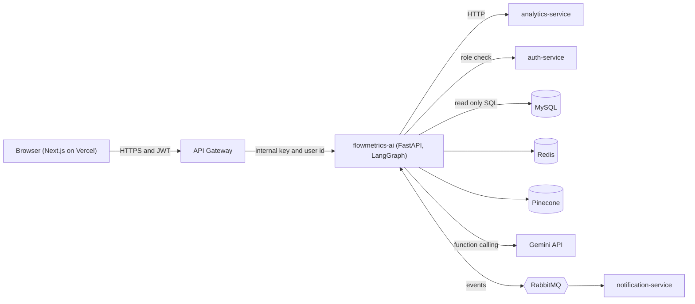
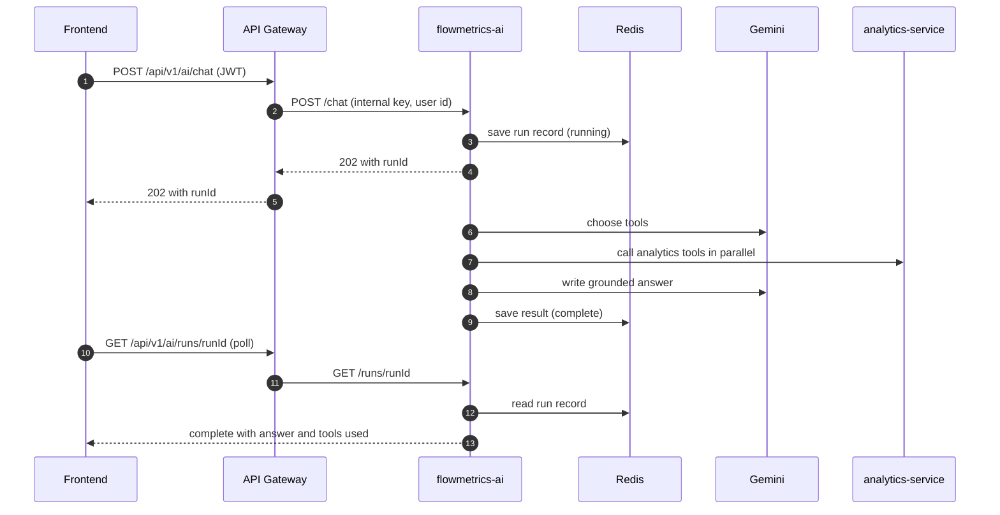
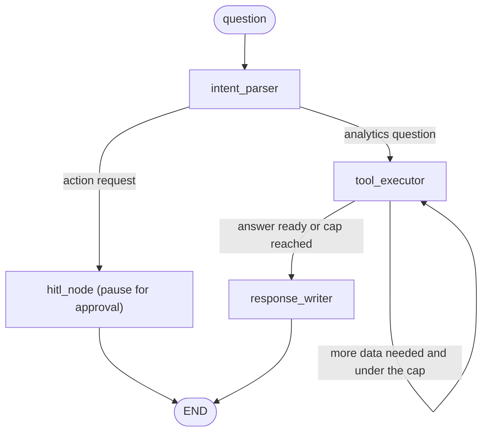

# flowmetrics-ai

An agentic AI analyst microservice for **FlowMetrics**, a microservices platform that tracks DORA metrics for GitHub repositories. Ask a question in plain language, and a LangGraph agent decides which analytics tools to call, retrieves relevant pull request and commit text, and answers using only the data it retrieved.


<!-- Add screenshots here, for example:  -->

## Contents

- [What it does](#what-it-does)
- [Architecture](#architecture)
- [Features in detail](#features-in-detail)
- [Security model](#security-model)
- [API reference](#api-reference)
- [Event contracts](#event-contracts)
- [Data stores](#data-stores)
- [Configuration](#configuration)
- [Getting started](#getting-started)
- [Deployment](#deployment)
- [Testing and verification](#testing-and-verification)
- [Project structure](#project-structure)
- [Design decisions and trade-offs](#design-decisions-and-trade-offs)
- [Known limitations](#known-limitations)
- [Roadmap](#roadmap)

## What it does

| Capability | Description |
|---|---|
| **Conversational analytics agent** | Answers questions such as "Which pull requests have waited the longest?" by choosing from 9 tools (8 analytics APIs plus document search), calling independent tools in parallel, and writing a grounded answer. |
| **Human approval for actions** | When a request asks for an action (comment on a pull request, assign a reviewer, create an issue), the agent pauses and waits for an owner or admin to approve or reject. Paused runs survive a server restart. |
| **Hybrid retrieval (RAG)** | Pull request titles and commit messages are embedded into Pinecone and also indexed with BM25. Meaning search and keyword search are combined into one ranking. |
| **Hourly anomaly detection** | A scheduled job checks every repository with four rule-based detectors, asks the model for a short explanation, and publishes an alert event that the notification service emails. |
| **AI weekly digest** | Consumes the weekly digest event, writes a short summary from live metrics, and publishes it for the notification service to email. The original template digest still sends if the model call fails. |

The service is **additive**. If it is down, the API gateway returns `{ "fallback": true }` and the frontend hides the AI panel. The rest of the platform keeps working.

## Architecture



### Life of a question

Questions run asynchronously. The browser starts a run, receives a ticket, and polls for the result. This keeps every HTTP request short, so proxy and hosting timeouts cannot cut off a slow run.



### Agent graph



- `intent_parser` seeds the conversation and routes by keyword. Questions that ask for an action go to the approval node.
- `tool_executor` asks Gemini what to do next. The model may request several independent tools in one step, and they run concurrently. Results are returned to the model until it has enough data. A cap (`MAX_ITERATIONS` in `src/graph/agent.py`) stops runaway loops.
- `response_writer` is a fallback. It writes the answer from collected data when the cap is reached, and it says that the data may be incomplete.
- `hitl_node` uses a LangGraph `interrupt()`. State is saved by a custom Redis checkpointer, and the run resumes when a decision arrives.

## Features in detail

### Agent tools

| Tool | Data source (analytics-service) |
|---|---|
| `get_dora_metrics` | DORA metrics and levels |
| `get_cycle_time_trend` | Weekly cycle time and lead time |
| `get_contributor_stats` | Authors, reviewers and commits |
| `get_review_heatmap` | Review activity by day and hour |
| `get_open_prs` | Open pull requests, flagged stale or critical |
| `get_deployment_history` | Deployment frequency and build duration |
| `get_pr_size_analysis` | Pull request size buckets vs cycle time |
| `get_contributor_trend` | Week by week activity for one engineer |
| `search_context` | Hybrid search over pull request and commit text |

Tool schemas are plain Python functions with type hints and docstrings. The Gemini SDK builds the function declarations from them. Automatic function calling is disabled, so the application runs the tools itself and keeps results in graph state.

### Grounding and failure handling

- The system prompt fixes the repository id for every call (the application also overwrites any id the model picks), forbids inventing numbers, and treats empty results as "no data". Zero deployments is never reported as good performance.
- A failing tool returns an error object to the model instead of crashing the run, so partial answers are still possible.
- Gemini calls retry on 429, 500, 503 and 504 responses, and switch to a configured fallback model. Other errors fail immediately and loudly.
- Each run has a timeout, an iteration cap, a per-user lock (one running question per user) and a global concurrency limit, because the free Gemini tier allows only a few requests per minute.

### Hybrid retrieval

1. **Embedding.** `python -m src.rag.embedder <repoId>` embeds pull requests, the 150 most recent commits and a small set of shared reference documents (Gemini embeddings at 768 dimensions) and upserts them into Pinecone with a `repo_id` metadata filter.
2. **Search.** Each query runs two searches in parallel: vector search in Pinecone (this repository plus shared documents) and BM25 keyword search built from the database.
3. **Merge.** The two score lists use different scales, so each is min-max normalized to 0..1 before being combined with weights of 0.6 (meaning) and 0.4 (keywords). Documents found by both searches rank highest.
4. **Degradation.** If one search fails, the other still answers.

### Human in the loop

- A paused run is stored as a checkpoint in Redis and as a pending request visible through `GET /hitl/pending`.
- `POST /hitl/approve` claims the decision with an atomic Redis delete, so when two people click at the same moment, only the first decision counts. The second receives `409`.
- Only organization **owners and admins** can approve. If resuming fails, the pending request is restored so the reviewer can retry.
- Approving currently records the decision only. No action is executed on GitHub yet.

### Anomaly detection

| Detector | Fires when |
|---|---|
| `cycle_time_spike` | The latest week averages at least 24 hours and more than 2x the average of earlier weeks (needs 2 or more earlier weeks, and data no older than 14 days). |
| `deployment_failure` | 30 percent or more of deployments failed in the last 28 days (needs at least 3 deployments). |
| `stale_prs` | 3 or more open pull requests are stale, or any one is critical. |
| `no_deployments` | No deployments for 14 days, for a repository that deployed in the previous 84 days. |

Thresholds are named constants in `src/anomaly/detector.py`. A job runs every hour (APScheduler), asks the model for a two sentence explanation (with a plain-text fallback), and publishes `anomaly.detected`. A 24 hour Redis cooldown per repository and anomaly type prevents repeat emails.

### Weekly digest

The service consumes `weekly.digest`, collects 30 day DORA data, 7 and 30 day cycle time, 28 day deployments, 7 day contributors and the first 10 open pull requests, and asks the model for a short four part summary. It publishes `ai.digest.ready`, which the notification service turns into an email. A failure in this path never blocks the original digest.

## Security model

- **Gateway only.** Every route except `/` and `/health` requires an `x-internal-key` header that only the API gateway knows (compared in constant time). In production a missing key setting makes the service refuse all requests.
- **Identity.** The gateway verifies the user's JWT and forwards only the user id. The login token, cookies and GitHub token are never sent to this service.
- **Authorization.** For every request the service looks up the repository's real organization in MySQL (never trusting an organization id from the browser) and asks auth-service for the user's role there. Viewing needs owner, admin or member. Approving needs owner or admin.
- **Fails closed.** If auth-service cannot be reached, the request is refused.
- **Route allowlist.** The gateway forwards only `POST /chat`, `GET /runs/{id}`, `GET /hitl/pending` and `POST /hitl/approve`. Admin and test endpoints cannot be reached from the internet.
- **Abuse limits.** Question length is capped, each user has a request rate limit and a single running question, and run records are readable only by the user who asked.
- **Production hardening.** Interactive API docs are disabled and CORS is off in production, since browsers never call this service directly.

## API reference

All routes except `/` and `/health` require the gateway's internal key. The last column shows whether the gateway exposes the route to browsers.

| Method | Path | Purpose | Via gateway |
|---|---|---|---|
| GET | `/` | Liveness, always 200 (use this for platform health checks) | no |
| GET | `/health` | Checks MySQL, Redis, RabbitMQ and analytics-service. Returns 503 when degraded | no |
| POST | `/chat` | Start a question. Returns `202 { runId, status: "running" }` | yes |
| GET | `/runs/{runId}` | Poll a run: `running`, `complete`, `pending_approval`, `failed` or `not_found` | yes |
| GET | `/hitl/pending?repoId=N` | List requests waiting for approval | yes |
| POST | `/hitl/approve` | Approve or reject a paused run | yes |
| POST | `/anomaly/scan` | Scan one repository now (`demo: true` sends a test alert) | no |
| POST | `/digest/preview` | Generate a weekly summary without sending it | no |
| GET | `/rag/search?repoId=N&q=text` | Debug the hybrid search | no |
| POST | `/chat/stream` | Experimental streaming variant. Not used by the frontend | no |

Example start request body:

```json
{ "repoId": 2, "orgId": 1, "question": "Which pull requests have waited the longest?" }
```

## Event contracts

Exchange `flowmetrics` (topic, durable).

| Direction | Routing key | Payload fields |
|---|---|---|
| Consumes | `weekly.digest` (queue `ai.weekly_digest`) | `recipientEmail`, `orgName`, `repoName`, `repoId` |
| Publishes | `anomaly.detected` | `recipientEmail`, `repoName`, `repoId`, `anomalyType`, `description`, `currentValue`, `threshold`, `detectedAt` |
| Publishes | `ai.action_requested` | `runId`, `repoId`, `proposedAction`, `actionType`, `reasoning`, `requesterEmail` |
| Publishes | `ai.digest.ready` | `recipientEmail`, `orgName`, `repoName`, `repoId`, `subject`, `narrative`, `generatedAt` |

## Data stores

**MySQL (read only).** Reads `repositories`, `pull_requests`, `pr_reviews`, `commits` and `deployments` from the `flowmetrics_github` database. The service never writes to it.

**Redis keys**

| Key | Contents | TTL |
|---|---|---|
| `ai_run:{runId}` | LangGraph checkpoint (hash) | 24 hours |
| `ai_result:{runId}` | Run record: status, answer, tools used | 24 hours |
| `hitl_pending:{runId}` | Pending approval request | 48 hours |
| `ai_rate:{userId}:{minute}` | Per-user request counter | 2 minutes |
| `ai_lock:{userId}` | One running question per user | 200 seconds |
| `anomaly_sent:{repoId}:{type}` | Alert cooldown | 24 hours |

**Pinecone.** One serverless index with cosine similarity and 768 dimensional vectors. Metadata includes `repo_id`, `kind` and `text`. Shared reference documents use `repo_id` 0.

## Configuration

Copy `.env.example` to `.env` and fill in the values. Never commit `.env`.

| Variable | Purpose |
|---|---|
| `ENVIRONMENT` | `development` or `production`. Production requires `INTERNAL_API_KEY`, disables docs and CORS |
| `PORT` | Listen port (default 3006) |
| `INTERNAL_API_KEY` | Shared secret with the API gateway (`AI_INTERNAL_KEY` on the gateway) |
| `DB_HOST`, `DB_PORT`, `DB_USER`, `DB_PASS`, `DB_NAME`, `DB_SSL` | MySQL connection (`flowmetrics_github`) |
| `REDIS_URL` | Redis connection |
| `RABBITMQ_URL` | RabbitMQ connection |
| `ANALYTICS_SERVICE_URL` | analytics-service address |
| `AUTH_SERVICE_URL` | auth-service address (role lookups) |
| `GEMINI_API_KEY` | Gemini API key |
| `GEMINI_MODEL`, `GEMINI_FALLBACK_MODEL` | Primary and backup model names |
| `PINECONE_API_KEY`, `PINECONE_INDEX_NAME` | Vector database |
| `ALERT_EMAIL` | Recipient of anomaly alerts |

Optional tracing: set the LangSmith environment variables to trace graph runs.

## Getting started

### Prerequisites

Python 3.13, access to a MySQL database with the FlowMetrics schema, Redis, RabbitMQ, a running analytics-service and auth-service, a Gemini API key and a Pinecone key.

### Run locally

```bash
python -m venv .venv
# Windows PowerShell:  .venv\Scripts\activate
# macOS or Linux:      source .venv/bin/activate
pip install -r requirements.txt
cp .env.example .env          # then edit .env
uvicorn src.main:app --reload --port 3006
```

With `ENVIRONMENT=development` and no `INTERNAL_API_KEY`, interactive docs are available at `http://localhost:3006/docs` and requests are accepted without the gateway headers.

On Windows the project forces the selector event loop (see `src/main.py`), because the default loop has problems with SSL sockets under `aiomysql`.

### Fill the vector index

```bash
python -m src.rag.embedder 2      # embed repository 2
```

### Try a question

```bash
curl -X POST http://localhost:3006/chat \
  -H "Content-Type: application/json" \
  -d '{"repoId":2,"orgId":1,"question":"What pull requests are open?"}'
# copy the runId, then poll:
curl http://localhost:3006/runs/<runId>
```

If `INTERNAL_API_KEY` is set, add the headers `x-internal-key: <key>` and `x-user-id: <user id>` to every call.

### Docker

```bash
docker build -t flowmetrics-ai .
docker run --rm -p 3006:3006 --env-file .env \
  -e REDIS_URL=redis://host.docker.internal:6379 \
  -e ANALYTICS_SERVICE_URL=http://host.docker.internal:3003 \
  -e AUTH_SERVICE_URL=http://host.docker.internal:3001 \
  flowmetrics-ai
```

`--env-file` does not remove quotes or allow spaces around `=`, so keep `.env` in strict `KEY=VALUE` form. The container runs one worker on purpose (see limitations).

## Deployment

Deployed as a Docker web service (for example on Render).

- Set the **health check path to `/`**, not `/health`. `/health` reports failure when analytics-service is asleep, which would make the platform restart this service repeatedly.
- Put the service in the same region as the other services and the database.
- Set every variable from the configuration table in the platform's environment settings. Set `ENVIRONMENT=production` and a new random `INTERNAL_API_KEY`, and give the gateway the same value.
- Run **exactly one instance**. The hourly scheduler and the RabbitMQ consumer live in the process, and the keyword index is cached in memory.
- Do not run a local copy at the same time. It would share the RabbitMQ queue and split messages.
- The service must stay awake for scheduled scans and digests. On a free tier that sleeps, those run only while the service is awake.

## Testing and verification

There is no automated test suite yet (see the roadmap). The project is verified with scripts and manual checks:

- `python test_day1.py` checks MySQL, Redis, RabbitMQ and all analytics-service wrappers.
- `python -m src.graph.test_agent` runs the agent end to end.
- Manual checks: start a run and poll it, confirm requests without the internal key return 401, a user outside the organization returns 403, a repeated approval returns 409, and a paused run resumes after the server restarts.

## Project structure

```
flowmetrics-ai/
├── Dockerfile
├── requirements.txt
├── test_day1.py                    infrastructure and analytics smoke test
└── src/
    ├── main.py                     app, lifespan (connections, scheduler, consumer), routers
    ├── api/
    │   ├── security.py             gateway key check, role based repository access
    │   ├── rate_limit.py           per-user rate limit and run lock
    │   ├── run_store.py            run records in Redis
    │   └── routes/                 health, chat, hitl, anomaly, digest, rag
    ├── config/                     settings, async MySQL, Redis, RabbitMQ, LLM helper
    ├── graph/                      agent graph, state, Redis checkpointer, nodes
    ├── tools/                      analytics client, Gemini tool schemas and dispatcher
    ├── rag/                        embedder, hybrid retriever, shared clients and corpus
    ├── anomaly/                    detectors and scanner
    ├── digest/                     weekly summary generator
    └── consumers/                  RabbitMQ weekly digest consumer
```

## Design decisions and trade-offs

- **LangGraph for the agent.** Approval needs saved, resumable state, and an explicit graph keeps the flow easy to follow and cap.
- **Custom Redis checkpointer.** Uses plain Redis commands, so it runs on any hosted Redis without extra modules. State is serialized with pickle, so Redis must be private and trusted.
- **Start then poll, instead of one long request.** Runs can take a minute on the free model tier. Short requests survive proxy and hosting timeouts.
- **Normalize before merging search scores.** BM25 and cosine scores live on different scales, so they are min-max normalized first. Otherwise the larger numbers would always win.
- **The gateway is the only door.** A shared secret plus a role check in this service means a leaked internal address is not enough to read data.
- **Fail closed on access, fail open on convenience.** If access cannot be verified, the request is refused. If saving a cached result fails, the user still gets the answer.
- **Rule-based anomaly detection with an LLM only for wording.** The decision is deterministic and testable. The model only explains it.
- **Read-only database access.** The service cannot damage platform data.

## Known limitations

- Each question is answered on its own. There is no conversation memory yet.
- Approving a request records the decision only. No GitHub action is executed.
- Intent routing is keyword based.
- Anomaly alerts go to one configured address, because the service cannot look up users' emails.
- The free Gemini tier allows about 5 requests per minute, so busy periods slow or fail answers. A paid tier removes the cap.
- One instance only. Scaling out needs leader election for the scheduler and a shared search cache.
- The keyword index is cached per repository until restart, so new pull requests appear in keyword search after a restart.
- Reranking of search results is not enabled.
- No automated test suite and no answer quality benchmark yet.

## Roadmap

- Automated tests with a mocked model, plus an evaluation set of real questions to measure tool choice and answer correctness.
- Follow-up memory: send the last few question and answer pairs as context.
- Execute approved actions (post a pull request comment) with scoped GitHub permissions.
- Optional cross-encoder reranking of search results.
- Streaming progress while tools run.
- Metrics and tracing dashboards, and leader election to allow more than one instance.

## Author

Built by Aditya Kumar as part of the FlowMetrics platform.
